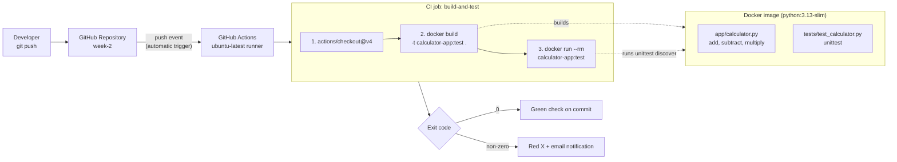

# Calculator CI — Architecture & Runbook

## 1. Purpose

A small Python 3 calculator (add, subtract, multiply on two positive integers), packaged in Docker, with a GitHub Actions pipeline that builds the image and runs the unit tests inside the container on every push.

## 2. Architecture Diagram



## 3. Components

| Component | File | Role |
|---|---|---|
| Application | `app/calculator.py` | `add`, `subtract`, `multiply`; validates inputs are positive integers (rejects 0, negatives, floats, booleans) |
| Unit tests | `tests/test_calculator.py` | 7 `unittest` cases covering the three operations and the validation rules |
| Container | `Dockerfile` | `python:3.13-slim`, copies `app/` and `tests/`, default command runs `python -m unittest discover -s tests -v` |
| Pipeline | `.github/workflows/ci.yml` | On push: checkout → build image → run tests in container |

## 4. Pipeline Flow

1. Developer pushes a commit to GitHub.
2. GitHub fires the `push` event; the workflow starts automatically (no webhook setup needed).
3. A fresh `ubuntu-latest` runner checks out the code.
4. `docker build -t calculator-app:test .` builds the image.
5. `docker run --rm calculator-app:test` runs the unit tests inside the container.
6. The container's exit code decides the job result: `0` = pass, anything else = fail.

## 5. Runbook

### 5.1 Run locally (no Docker)
```bash
python -m unittest discover -s tests -v
```

### 5.2 Run locally (Docker)
```bash
docker build -t calculator-app:test .
docker run --rm calculator-app:test
```
Expected: `Ran 7 tests ... OK`.

### 5.3 Trigger the pipeline
```bash
git add .
git commit -m "your message"
git push origin main
```
Or: GitHub → **Actions** → *Calculator CI* → **Run workflow** (manual trigger).

### 5.4 Check the result
GitHub repo → **Actions** tab → latest run → job *Build Docker image and run tests* → expand each step.

### 5.5 Troubleshooting

| Symptom | Likely cause | Fix |
|---|---|---|
| Workflow doesn't start | `ci.yml` not under `.github/workflows/`, YAML error, or push to a branch the trigger doesn't cover | Check path and indentation; confirm trigger branches |
| `docker build` fails | Wrong `COPY` path or bad base image tag | Reproduce locally with `docker build`; fix the Dockerfile |
| `ModuleNotFoundError: app` | Tests run from wrong directory or `__init__.py` missing | Ensure `app/__init__.py`, `tests/__init__.py` exist; `WORKDIR /app` in Dockerfile |
| Tests fail in CI but pass locally | Python version difference | Local Python should match the image (3.13) |
| `permission denied` on checkout | Repo/Actions permissions | Settings → Actions → allow workflows; `permissions: contents: read` is set |

### 5.6 Rollback
```bash
git revert <bad-commit-sha>
git push origin main
```

## 6. Out of Scope

Deployment (e.g. AWS/Lambda) is not part of this submission. An earlier SAM/Lambda attempt was reverted in the git history.
